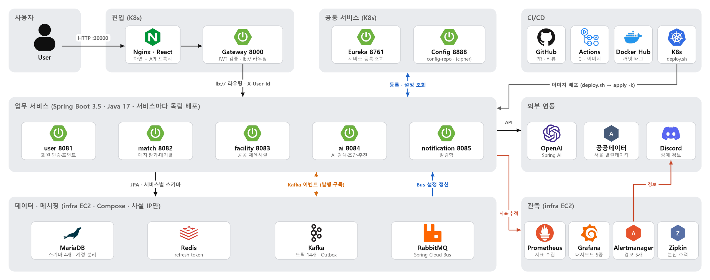
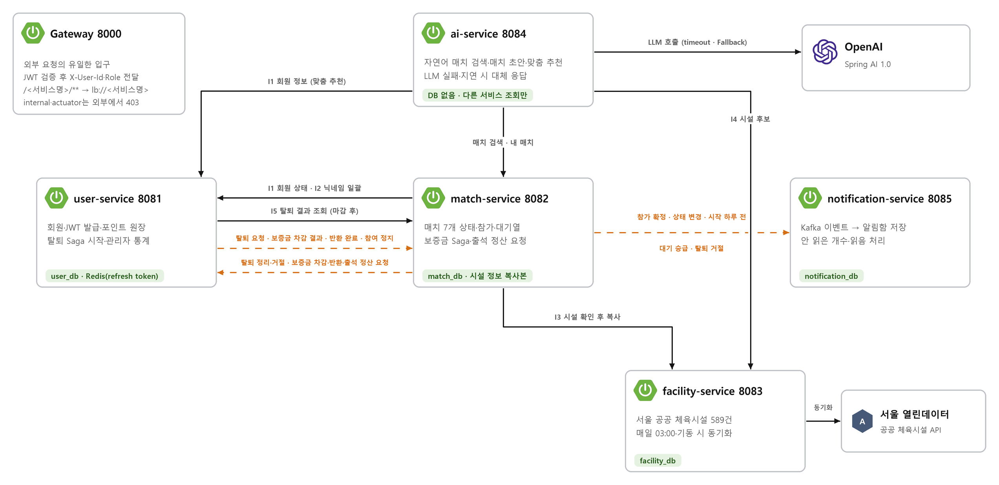
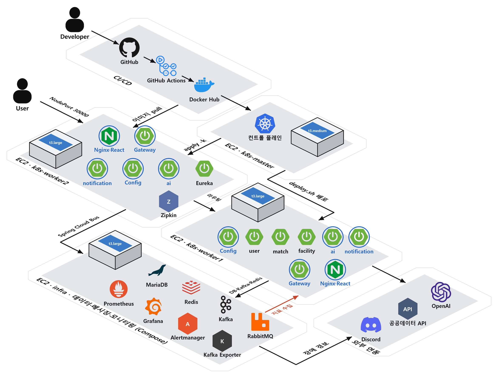

  

# Sporty v2

**운동할 사람과 장소를 연결하는 AI 기반 생활체육 매칭 플랫폼** 
LG CNS AM Inspire Camp 6기 · 미니프로젝트 2 · **2조 바톤터치**

 

Sporty는 서울시 공공 체육시설 정보를 살펴보고, 운동 모임을 만들거나 참여할 수 있는 서비스입니다. AI를 이용한 매칭 검색·초안 작성·추천 기능도 제공합니다. 시설 예약은 서울시 공공서비스예약 페이지로 연결해 안내합니다.

이번 프로젝트에서는 [1차 Sporty](https://github.com/livelykitten/inspire_6th_mini_1_sporty)의 모놀리식 구조를 서비스별로 분리하고, 서비스 간 통신과 운영 상황을 확인할 수 있는 구조로 고도화했습니다.

| 업무 서비스 | 공통 서비스 | API | Kafka 토픽 | 테이블 | AWS |
| :---: | :---: | :---: | :---: | :---: | :---: |
| **5개** | **3개** | **41개** | **14개** | **16개** | **EC2 4대 · Pod 15개** |

## Sporty v2에서 만드는 것

- **운동 매칭:** 서울시 체육시설을 탐색하고 운동 모임을 생성·검색·참가하며, 모집·진행·완료·취소 상태를 관리합니다.
- **AI 지원:** 자연어 매치 검색, 모임 초안 작성, 개인화 추천을 제공하고 외부 AI 장애 시 대체 응답으로 처리합니다.
- **Kafka 알림:** 참가, 모집 마감, 모임 취소 등 주요 이벤트를 사용자별 알림함으로 전달합니다.
- **포인트·출석:** 모임 생성·참가 보증금과 출석·노쇼에 따른 포인트 정산을 관리합니다.
- **운영 모니터링:** React 관리자 대시보드와 Grafana에서 서비스 상태·응답시간·오류율·Kafka 지연을 확인하고, 장애·부하 테스트로 지표 변화와 복구를 검증합니다.
- **회원 탈퇴 Saga:** 회원·매치 서비스의 탈퇴 처리를 연결하고, 실패 시 보상과 시간 초과 후 결과 재조회로 데이터 정합성을 관리합니다.

## 서비스 구성

| 서비스 | 주요 역할 |
| --- | --- |
| `user-service` | 인증, 회원·프로필, 포인트·정산, 회원 탈퇴 Saga |
| `match-service` | 운동 모임, 참가·대기열, 출석·상태 전이, 매치 정리 |
| `facility-service` | 서울시 체육시설 데이터 조회·동기화 |
| `ai-service` | 자연어 검색, 모임 초안, 개인화 추천·Fallback |
| `notification-service` | Kafka 이벤트 구독, 사용자별 알림 저장·조회 |

React 프론트엔드는 API Gateway를 통해 서비스에 접근합니다. Gateway는 JWT와 관리자 권한을 검증하며, Eureka는 서비스 발견을, Config Server는 설정 관리를 담당합니다.

시스템 아키텍처 · 진입(nginx·Gateway) → 공통 서비스(Eureka·Config) → 업무 서비스 5개 → 데이터·메시징 / 관측 · 외부 연동 · CI/CD

서비스 간 동기 조회는 OpenFeign, 비동기 이벤트 전달은 Kafka를 사용합니다. 각 서비스는 자신이 소유한 DB만 직접 접근하며, Outbox와 이벤트 중복 처리 방지로 데이터 정합성을 관리합니다.

서비스 아키텍처 · 실선 = OpenFeign 동기 호출(I1~I5 내부 API) · 주황 점선 = Kafka 이벤트(Outbox · eventId 중복 무시 · DLT)

Micrometer·Prometheus·Grafana를 중심으로 지표를 수집·시각화하고, Zipkin 분산 추적과 Alertmanager·Discord 경보로 장애 분석과 대응을 지원합니다.

AWS 배포 · EC2 4대(kubeadm master 1 · worker 2 · infra 1) · 파란 원은 replicas 2로 worker마다 나눠 띄운 무상태 서비스

## 저장소

| 저장소 | 용도 |
| --- | --- |
| [platform](https://github.com/batontouch-sporty/platform) | 제품 요구사항, MSA 아키텍처, 서비스 간 계약, 통합 개발·운영 문서 |
| [backend](https://github.com/batontouch-sporty/backend) | 백엔드 서비스와 인프라 구성 |
| [frontend](https://github.com/batontouch-sporty/frontend) | 사용자 웹 화면 |
| [config-repo](https://github.com/batontouch-sporty/config-repo) | 서비스별 외부 설정 |

## 팀 바톤터치

1차 Sporty를 이어받아 2차로 넘긴다는 뜻입니다.

|  |  |  |  |
| :---: | :---: | :---: | :---: |
| **이상혁** · 팀장 Gateway · JWT · Config 배포·CI · 프론트 | **안지산** · 부팀장 QA · 문서 | **최환우** · 부팀장 매칭 B · 참가·대기열 | **손호성** 매칭 A · ERD |
| [@GREED-YI](https://github.com/GREED-YI) | [@Ahnjisan](https://github.com/Ahnjisan) | [@choihwanwoo](https://github.com/choihwanwoo) | [@hssondev](https://github.com/hssondev) |
|  |  |  |  |
| **진성민** 회원 · 알림 | **박선아** 시설 · AI | **서우영** 모니터링 · 포인트 | **나유성** 인프라 · K8s |
| [@VirginiaToVegas](https://github.com/VirginiaToVegas) | [@noxisna](https://github.com/noxisna) | [@uyeongseo](https://github.com/uyeongseo) | [@yusung0520](https://github.com/yusung0520) |

> **진행 상태 (2026-11-04):** 서비스 8개를 AWS EC2 4대(kubeadm 클러스터 + infra Compose)에 배포해 운영 중입니다. 실행 방법과 세부 결과는 각 저장소의 README와 [platform](https://github.com/batontouch-sporty/platform) 문서에 기록합니다.
